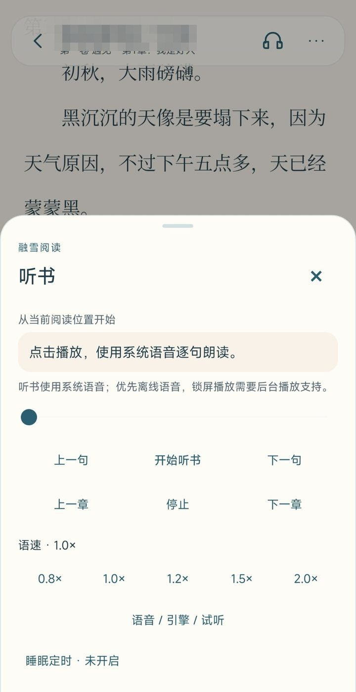
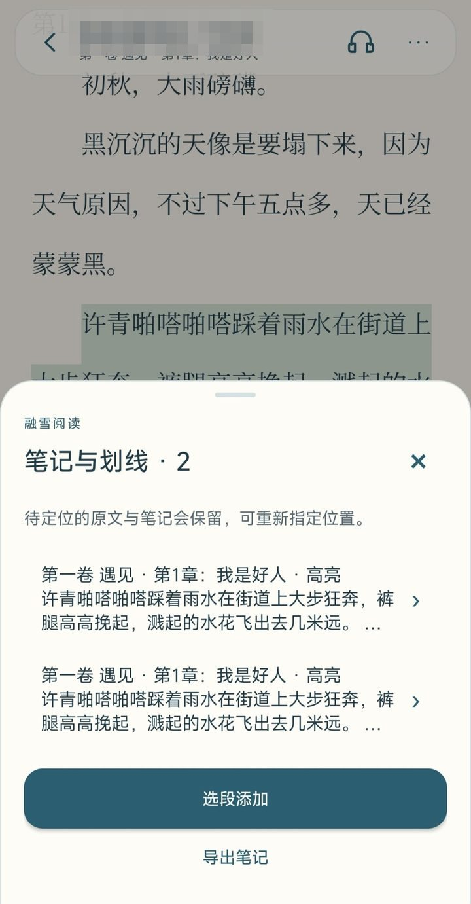

# 融雪阅读 · SnowRead

> 雪渐融，故事正生长。

**更新提示：0.16.8 安装包已撤回，阅读工具栏入场修正见 [v0.16.9 说明](UPDATE-v0.16.9.md)。已安装0.16.8可直接更新，无需卸载。**


融雪阅读是一款以本地 TXT / EPUB 文字阅读为主的原生 Android 阅读器，由个人开发维护。纸色阅读背景搭配冷色界面，支持分页与滚动两种阅读模式，设计上尽量克制：不设广告，不接入第三方统计与崩溃上报，书籍与阅读记录只保存在设备本地。

当前源码：**v0.16.9（公开测试版）** · Android 6.0 / API 23 及以上 · 应用标识 `com.snowread.app`

**[前往 Releases 下载](https://github.com/nhwjzs-cyber/SnowRead/releases)**

## 界面预览

| 书架 | 阅读（白天） |
| --- | --- |
|  |  |

| 阅读（夜读） | 听书 |
| --- | --- |
|  |  |

| 笔记与划线 |
| --- |
|  |

## 功能

- 本地 TXT / EPUB 单本、批量和文件夹导入，书架分类、多分类、置顶与多选管理。
- 书籍备注、独立阅读状态与已读筛选；TXT导出为文字型EPUB。
- 章节与分卷识别、目录跳转、阅读进度、书签和正文搜索；支持目录识别预览与按书选择识别规则。
- 常驻页脚（默认开启）：进度、时间、电量；可选章节页眉（默认关闭），主题跟随阅读纸色。
- 阅读统计页：近16周日历、每日按书时长与今日/本周/累计概览，数据仅保存在本机。
- 分页与滚动阅读、仿真卷页与完成时边框雪尘、夜读模式、按书独立排版与自定义字体。
- 按书离线简繁显示，保留原始 TXT、书签和笔记位置。
- 选段高亮、下划线与备注，支持摘录/备注搜索和样式筛选，并导出当前结果为 TXT / Markdown。
- 按书启用 TXT 正文净化，预览广告移除与字面替换，原始文件保留，可关闭并恢复原文。
- 系统离线语音听书，支持睡眠定时与后台播放。
- 整库备份与恢复（含自定义字体、可选阅读统计）、回收站，以及需手动开启的 Wi-Fi 局域网传书。
- 可手动选择的天气氛围与本地时间光线效果，配合克制的融雪与新芽动效。

支持本地无 DRM 的文字型 EPUB 2/3，包括目录和封面；复杂图文、固定版式及加密书籍暂不支持。单本最多12 MB，具体边界见 [UPDATE-v0.16.5.md](UPDATE-v0.16.5.md)。最新正文净化、笔记整理与兼容范围见 [UPDATE-v0.16.8.md](UPDATE-v0.16.8.md)。

## 安装与数据

请在 [Releases](https://github.com/nhwjzs-cyber/SnowRead/releases) 下载 v0.16.9 测试版，安装包文件名为 `SnowRead-v0.16.9-release.apk`；页面中的“隔离测试应用”与“隔离仪器测试”仅用于开发验证。源码目录不存放安装包。

覆盖更新前，建议先在应用内导出书库备份。由原作者签名的发布版可直接覆盖更新；自行编译的版本使用构建者自己的签名，通常无法直接覆盖原作者签名的安装包。

## 隐私

- 已移除 IP 定位和外部天气查询；天气效果由用户手动选择，时间取自本机。
- 未接入广告、第三方统计分析或崩溃上报 SDK。书籍、笔记、字体和阅读记录均存放在应用私有目录；应用内的阅读时长统计同样只保存在本机，不会上传。
- 网络权限仅用于用户手动开启的前台局域网传书。该功能使用未加密的 HTTP，请仅在可信局域网中使用；关闭面板或应用进入后台后即停止接收。
- 听书仅选择引擎声明为离线的语音。系统语音引擎是独立应用，其自身的联网行为无法由本项目保证。
- 主动导出的整库备份包含书籍、笔记与进度，请勿将私人备份上传到公开仓库。

详细检查记录见 [PRIVACY-REVIEW-v0.16.1.md](PRIVACY-REVIEW-v0.16.1.md)。

## 当前状态

v0.16.9 修正阅读工具栏入场时序。0.16.8 APK已撤回，请使用0.16.9覆盖更新。核心、存储与功能回归通过，发布 APK 的签名、资源表与非调试清单已检查。维护者此前反馈已在多品牌、多安卓版本设备上运行正常；本版新增正文净化与笔记界面用例仅编译，尚未设备执行。EPUB 插图、脚注跳转与跨书笔记仍未实现。发现问题欢迎通过 Issue 反馈。

其他存储与界面验证记录见 [VALIDATION.md](VALIDATION.md)。

## 构建

使用 Android Studio 打开仓库根目录即可，需要 Android SDK 35、JDK 17 或更高版本。项目自带 Gradle Wrapper，不依赖第三方阅读框架。

```bash
# Windows
.\gradlew.bat assembleDebug

# macOS / Linux
sh ./gradlew assembleDebug
```

仓库不包含开发者签名私钥，公开源码中的 Gradle 配置使用标准本地 debug 签名。另提供 Windows 便捷脚本 `Build-WithSdk.ps1`，支持 `-SdkRoot`、`-JdkHome` 和 `-Release` 参数；该脚本需要自行配置本地 `dev/debug.keystore`，不会随源码分发密钥。

## 项目结构

- `app/src/main/java/com/snowread/app/`：阅读、书架、存储、听书与原生界面。
- `app/src/main/assets/`：内置字体及虚构示例小说。
- `tests/`：宿主回归和隔离 Android 测试。
- `docs/`：方案、审查记录与历史文档；以当前源码和最新验证记录为准。

## 开发者与 AI 辅助

本项目由 [nhwjzs-cyber](https://github.com/nhwjzs-cyber) 发起和维护。开发过程中使用了 ChatGPT / Codex（OpenAI）、GLM（智谱）和 DeepSeek 辅助代码实现、问题排查、方案与体验审查，具体分工见仓库内的相关记录。以上标注仅为如实说明，不代表相应厂商官方参与或背书。

## 授权

本项目自有代码采用 [PolyForm Noncommercial License 1.0.0](LICENSE)，允许在许可范围内学习、研究、非商业修改和分享。除正式许可明确允许的情形或另行授权外，不授予将源码或改版用于商业与盈利目的的许可，包括打包出售、付费会员、订阅、付费解锁和广告变现。

因此，本项目属于**源码可用、非商业许可**，不按照允许商用的标准开源项目宣传。公益、教育等组织的标准许可例外和完整规则见 [中文使用说明](NONCOMMERCIAL.zh-CN.md) 与 [LICENSE](LICENSE)。分发时请保留 [NOTICE](NOTICE) 和许可声明。

简繁字词典来自 OpenCC ver.1.1.9，按 Apache-2.0 分发；见 [词典来源](app/src/main/assets/conversion/ABOUT.json)、[授权](app/src/main/assets/conversion/LICENSE) 与 [说明](app/src/main/assets/conversion/NOTICE.txt)。

内置宋体子集来自 Adobe 思源宋体，继续按 SIL OFL 1.1 分发；Gradle Wrapper 保留其自带的 Apache 2.0 许可。

---

**In short:** SnowRead is a local-first TXT and text-based EPUB reader for Android, developed and maintained by an individual. No ads, no analytics, no account — books, notes and reading progress stay on the device. It offers paginated and scrolling reading, offline text-to-speech, highlights and notes with Markdown export, full-library backup, and LAN book transfer. The source is available under the PolyForm Noncommercial License.
